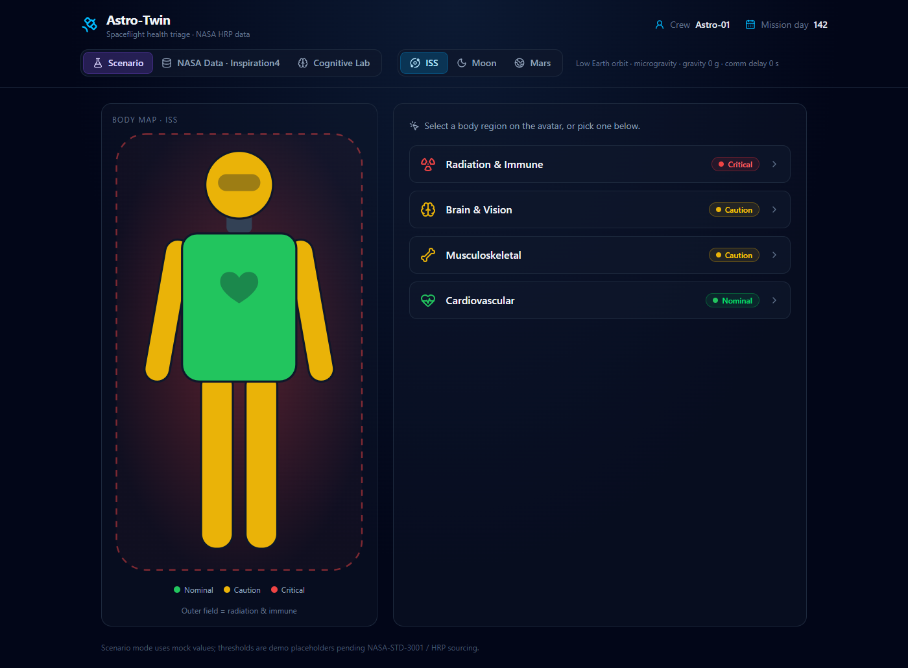
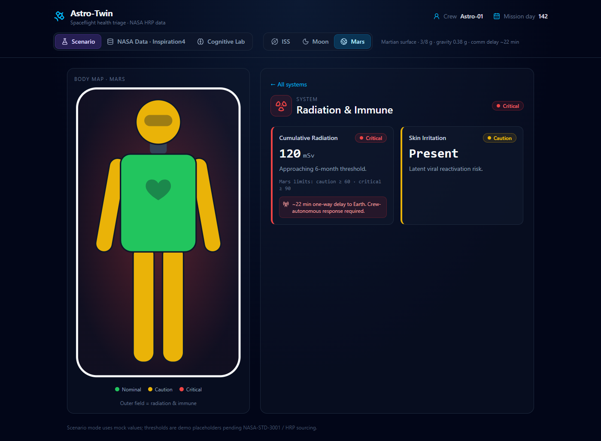
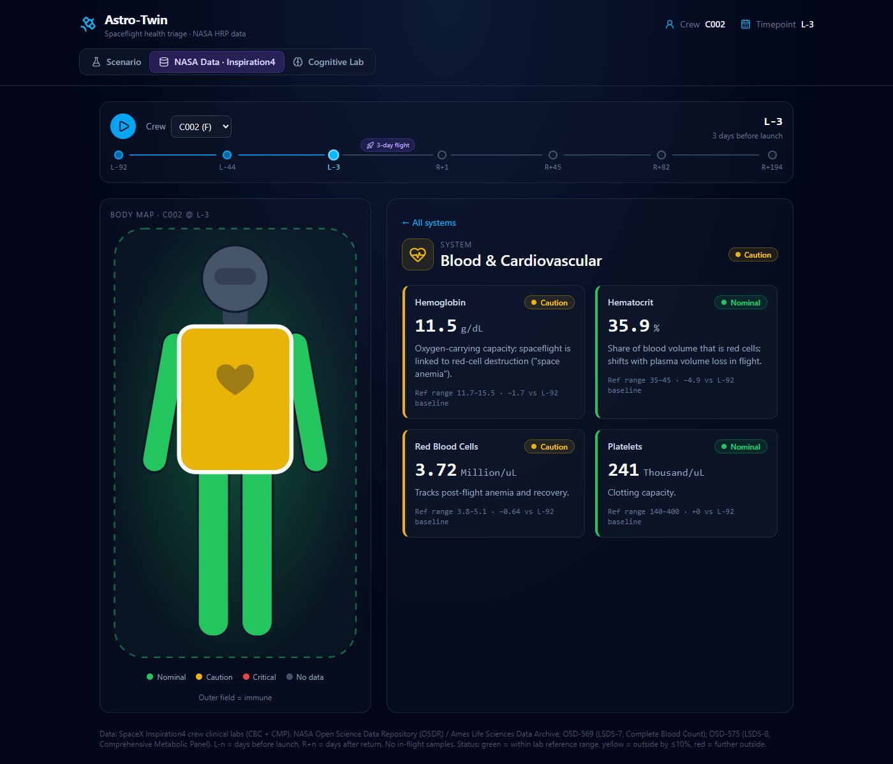
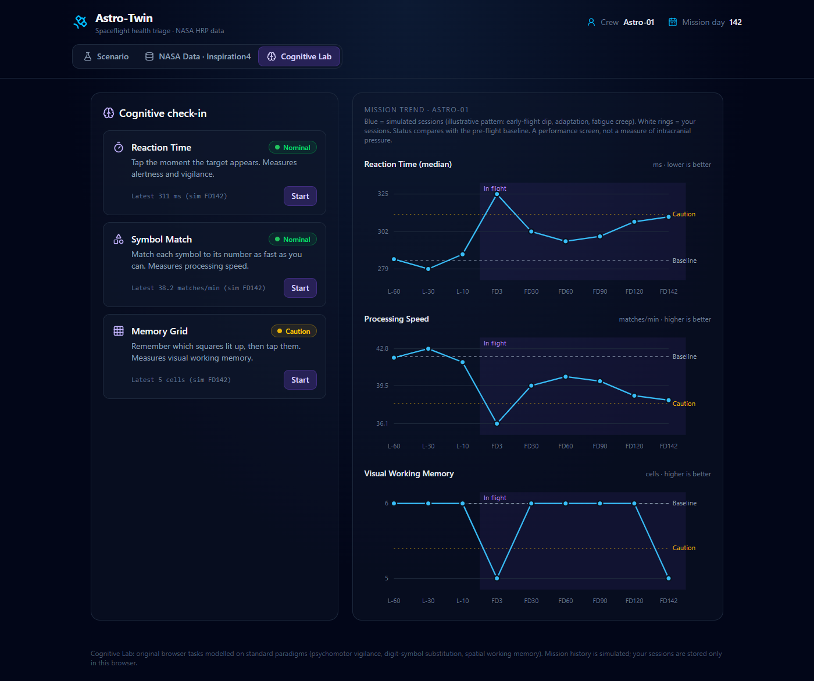
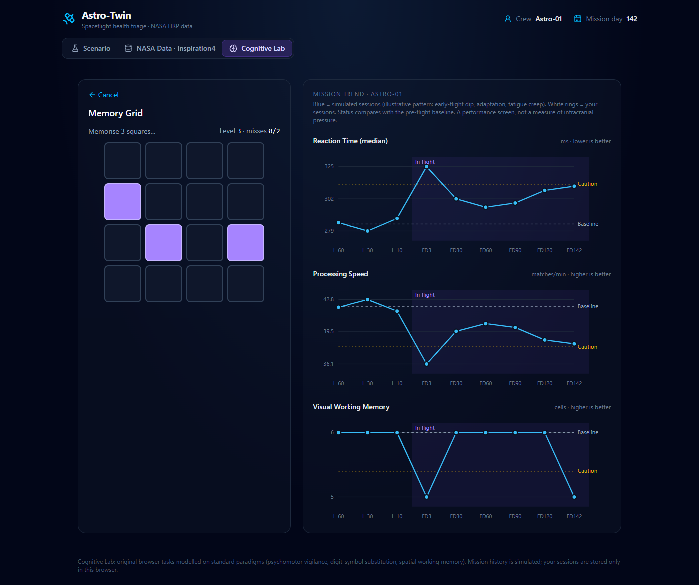

# Astro-Twin

**A visual health-triage tool for astronauts, built for the NASA Space Apps Challenge.**

Astro-Twin maps spaceflight health hazards onto an interactive human avatar. Each body region is colored by its status:
🟢 Nominal, 🟡 Caution, 🔴 Critical. Click a region to see the readings behind its color. The app has three modes:

- **Scenario**: a mission-day-142 astronaut on the ISS, Moon or Mars. Changing the environment changes the limits.
- **NASA Data · Inspiration4**: plays back real crew bloodwork from NASA's Open Science Data Repository across the mission timeline.
- **Cognitive Lab**: three short brain games measure reaction time, processing speed and visual memory. The results feed the avatar's head.



---

## Features

### Interactive body map
The avatar is an SVG figure split into four regions:

| Region | Covers |
|---|---|
| Head | Brain and vision |
| Torso | Cardiovascular system |
| Limbs | Musculoskeletal system |
| Surrounding field | Radiation and immune system |

Each region takes the color of its worst reading. The regions are clickable and can also be reached with the keyboard. The dashboard lists systems most-severe first, and each reading shows its value, its limits and a short explanation.

### ISS / Moon / Mars environments
Readings store only the measured values. Statuses are worked out from per-environment limits in [`src/data/environments.json`](src/data/environments.json):

- Partial gravity on the Moon and Mars loosens the limits for head and eye readings.
- Higher surface radiation tightens the radiation limits.
- On Mars, a critical reading also warns that the ~22-minute signal delay to Earth means the crew must act on their own.



### Real NASA data playback (Inspiration4)
Real lab results for all four Inspiration4 crew members are mapped onto the avatar:

- **Blood counts** feed the chest.
- **Calcium, alkaline phosphatase and creatinine** feed the limbs.
- **White blood cells** feed the outer field.

You can pick a crew member, then press play to step through 7 test dates, from 92 days before launch to 194 days after landing. Each value is graded against the lab's **own normal range**. Each card also shows the change from that crew member's pre-flight baseline.



### Cognitive Lab
The data has no brain or vision measurements, so we built three short games based on standard thinking tests:

| Game | Based on | Measures |
|---|---|---|
| Reaction Time | Psychomotor vigilance task | Median reaction time and lapses |
| Symbol Match | Digit-symbol substitution | Correct matches per minute |
| Memory Grid | Spatial span task | Visual working memory span |

Each result is compared with a pre-flight baseline and plotted on a mission-trend chart. In Scenario mode it also feeds the avatar's head.





---

## What's real and what's simulated

| Part | Status |
|---|---|
| Inspiration4 lab values and normal ranges | **Real NASA data** (OSDR studies OSD-569, OSD-575) |
| Scenario astronaut "Astro-01" values | Mock data based on known spaceflight risks |
| ISS / Moon / Mars limits | **Placeholders** for the demo, to be replaced with NASA-STD-3001 / HRP values |
| Cognitive Lab mission history | **Simulated**. The pattern (early-flight dip, adaptation, fatigue) is for illustration |
| Your Cognitive Lab sessions | Real results from you, stored only in your browser |

The cognitive games measure thinking performance. They are **not** a measure of brain pressure or a medical diagnosis.

One data-quality note: crew member C003's first test (L-92) has platelet and neutrophil values about 25× and 400× below their other readings, which looks like a data-entry error. The app marks such values **"Data check"** rather than raising a false alarm.

---

## Data sources

- **NASA Open Science Data Repository (OSDR)**, which hosts the Ames Life Sciences Data Archive (ALSDA): https://osdr.nasa.gov/bio/
  - [OSD-569](https://osdr.nasa.gov/bio/repo/data/studies/OSD-569): Inspiration4 Complete Blood Count (LSDS-7)
  - [OSD-575](https://osdr.nasa.gov/bio/repo/data/studies/OSD-575): Inspiration4 Comprehensive Metabolic Panel (LSDS-8)
  - Raw files: [`data-raw/osdr/`](data-raw/osdr/) ([source notes](data-raw/osdr/README.md))
  - Repository paper: *NASA Open Science Data Repository*, Nucleic Acids Research 53 (2025) D1697–D1710, [doi:10.1093/nar/gkae1116](https://doi.org/10.1093/nar/gkae1116)
- [About ALSDA](https://www.nasa.gov/?p=691160) · [OSDR FAQ](https://science.nasa.gov/reference/osdr-faq)
- **NASA Human Research Program (HRP)**: [Human Research Program](https://www.nasa.gov/hrp/) · [HRP Human Research Roadmap](https://humanresearchroadmap.nasa.gov/)
- **NASA-STD-3001** (Spaceflight Human-System Standard): [Vol. 1, Crew Health](https://standards.nasa.gov/node/238) · [Vol. 2, Human Factors, Habitability & Environmental Health](https://standards.nasa.gov/node/237) · [NASA Human Spaceflight Standards overview](https://www.nasa.gov/offices/ochmo/human_spaceflight/standards101)
- **Cognition in spaceflight**:
  - [Penn Medicine: first study of a civilian space crew (Inspiration4)](https://pennmedicine.org/news/news-releases/2024/june/first-study-of-civilian-space-crew-charts-course-for-research-as-commercial-flight-heats-up)
  - [Penn: Astronaut Behavioral Health](https://www.med.upenn.edu/uep/astronaut.html)
  - [Baylor College of Medicine / TRISH: Inspiration4 health data](https://www.bcm.edu/news/trish-shares-new-health-data-from-first-all-civilian-orbital-space-mission)

When citing an OSDR dataset, use the citation button on its study page.

---

## Getting started

Requires **Node.js 18+**.

```bash
git clone https://github.com/LuisAlegria519/Space-Health.git
cd Space-Health
npm install
npm run dev        # opens http://localhost:5174
```

| Command | What it does |
|---|---|
| `npm run dev` | Dev server with live reload on port **5174** (it fails rather than switching port if 5174 is taken) |
| `npm run build` | Production build into `dist/` |
| `npm run preview` | Serve the production build |
| `npm run data:osdr` | Regenerate `src/data/osdrTimeline.json` from the raw OSDR CSVs |

### Opening a specific view
URL parameters open the app straight into a given state, which is handy for demos:

```
?mode=scenario | osdr | cognitive
?crew=C001..C004        (OSDR mode)
?tp=0..6                (OSDR timepoint index)
?region=head | heart | musculoskeletal | fullbody
```

Example: `http://localhost:5174/?mode=osdr&crew=C002&tp=2&region=heart`

---

## Project structure

```
src/
  App.jsx                     App state (mode, selected region, environment, crew, timeline, sessions)
  components/
    AstroAvatar.jsx           SVG body map
    MissionDashboard.jsx      Region overview + metric cards
    EnvironmentToggle.jsx     ISS / Moon / Mars switch
    SimulationControls.jsx    Crew picker + timeline playback (OSDR mode)
    cognitive/                Cognitive Lab, the three games, trend chart
  lib/
    triage.js                 Threshold evaluation → statuses
    osdr.js                   OSDR analytes → body regions, reference-range grading
    cognition.js              Test definitions, baselines, simulated history, storage
  data/
    mockVitals.json           Scenario astronaut + daily routines
    environments.json         Per-environment thresholds (placeholders)
    osdrTimeline.json         Generated from data-raw/osdr
data-raw/osdr/                Unmodified NASA OSDR CSVs
scripts/build-osdr.mjs        CSV → JSON converter
```

**Built with:** React 18, Vite 6, Tailwind CSS 4, Lucide icons.

## Roadmap
- Habit rings for daily routines (exercise, fluid intake, cognitive check-in). The data is already in `mockVitals.json`.
- Replace the placeholder limits with sourced NASA-STD-3001 / HRP values.
- Entry fields for onboard eye and head measurements: eye scans, optic-nerve ultrasound and eye pressure.
